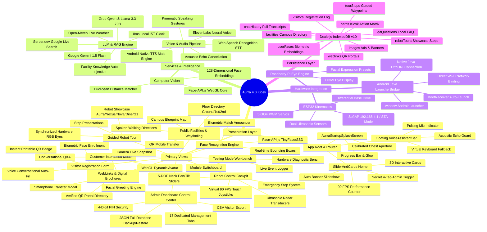

# AURRA 4.0 AUTONOMOUS SERVICE ROBOT & INTERACTIVE KIOSK
## COMPLETE TECHNICAL ANALYSIS, CODEBASE BLUEPRINT & ONBOARDING GUIDE

```
========================================================================================
PROJECT IDENTITY & METADATA
========================================================================================
Project Name        : Aurra 4.0 Interactive Kiosk & Autonomous Service Robot Application
Current Active Repo : d:\RAGUNATH\aurra\aurra_v
Branch              : oct-8 (Latest Active Release)
Company             : Robomiracle Technologies Private Limited
Location            : RS Puram, Coimbatore, Tamil Nadu, India
Target Hardware     : 12" 1920x1080 Capacitive Touch Display / Redmi Pad 2 Tablet (ARM64)
Microcontroller     : ESP32 Dual-Core (SoftAP 192.168.4.1 / Station Mode) + Raspberry Pi
Primary Framework   : React 19 + Vite 6 + Native Android Launcher Bridge (Java)
Database            : Dexie.js 4 (IndexedDB Schema v10) — 100% Offline-First
AI / LLM Engine     : Hybrid Google Gemini 1.5 Flash + Groq Llama 3.3 / Qwen + Serper RAG
Vision / Biometrics : Face-API.js (TinyFace / SSD Mobilenet v1 + 128D Face Embeddings)
Speech Systems      : HTML5 Web Speech STT + ElevenLabs / Android Native TTS Engine
========================================================================================
```

---

## 1. HIGH-LEVEL TECHNICAL OVERVIEW

### 1.1 What is Aurra 4.0?
**Aurra 4.0** is an enterprise-grade autonomous humanoid service robot engineered by **Robomiracle Technologies** for high-traffic environments including corporate headquarters, healthcare campuses, university atriums, and hospitality venues. 

Operating on Aurra's chest-mounted touch interface, the `aurra_v` application serves as the **cognitive and physical brain** of the robot. It unifies:
1. **Multimodal Human-Robot Interaction (HRI):** Touchscreen, continuous speech recognition, computer vision face recognition, and animatronic physical gestures.
2. **Contextual Knowledge & Generative AI (RAG):** Local offline FAQs + Real-time Google Search (Serper.dev) + Live local weather (Open-Meteo) + 0ms local IST clock intent + Google Gemini 1.5 Flash / Groq LLMs.
3. **Autonomous Facility Management:** Visitor registration with spoken auto-fill, camera snapshot capture, biometric face enrollment, and instant digital QR badge issuance.
4. **Wayfinding & Guided Tours:** Interactive multi-floor campus blueprint directory, walking directions, and autonomous robot presentations.
5. **Hardware Teleoperation & Kinematics:** 90 FPS virtual touch joysticks, 5-axis servo head/arm articulation, ultrasonic obstacle radar telemetry, and RGB animatronic eyes.

---

### 1.2 Evolution Across Workspace Directories

The workspace directory (`d:\RAGUNATH\aurra`) reflects four generations of robot software development:

| Directory | Architecture Version | Purpose & Evolution |
| :--- | :--- | :--- |
| `aurra 1.0` | **Gen 1 Prototype** | Legacy Python backend + static web frontend. Early voice and serial motor tests. |
| `aurra-2.0` | **Gen 2 Native Experiment** | Android Studio Java wrapper exploring native Android Webview integration. |
| `aurra_3.0` | **Gen 3 React + Python** | Modernized UI with React 18, FastAPI backend, and preliminary Dexie schemas. |
| `aurra_voice`| **Audio Research Lab** | Sarvam AI Indian speech experiments and Chatterbox TTS model testing. |
| **`aurra_v`** | **Gen 4 Production Release** | **The active, production codebase.** Pure edge-first client running React 19 + Vite 6 + Android Native LauncherBridge + IndexedDB Schema v10 + Gemini/Groq + ESP32. |

---

### 1.3 Architectural Paradigms

```
+---------------------------------------------------------------------------------------+
|                                    USER INTERACTION                                    |
|     12" Touch Display  |  Crystal Pro USB Camera  |  Stereo Mic  |  Fielect 20W Speaker|
+---------------------------------------------------------------------------------------+
                                           |
                                           v
+---------------------------------------------------------------------------------------+
|                           REACT 19 / VITE 6 KIOSK SHELL                               |
|   State-Based Router  |  Startup Tilted Aperture  |  Floating Voice Assistant Bar      |
+---------------------------------------------------------------------------------------+
      |                                    |                                    |
      v                                    v                                    v
+------------------------+  +-------------------------------+  +------------------------+
|   LOCAL PERSISTENCE    |  |       AI & SPEECH ENGINES     |  |   HARDWARE INTERFACES  |
| - Dexie.js Schema v10  |  | - Gemini 1.5 Flash / Groq     |  | - ESP32 192.168.4.1    |
| - 100% Offline Storage |  | - Serper.dev Google RAG       |  | - 5-DOF Servo Motors   |
| - Biometric Embeddings |  | - Open-Meteo Weather API      |  | - Ultrasonic Radar     |
| - Visitor Records      |  | - Face-API.js 128D Embeddings |  | - Raspberry Pi HDMI    |
| - Q&A Knowledge Base   |  | - Acoustic Echo Cancellation  |  | - Native Java Bridge   |
+------------------------+  +-------------------------------+  +------------------------+
```

1. **Zero-Latency Offline-First Core:** Critical kiosk operations (wayfinding, basic FAQs, registration, motor teleoperation, local IST clock) execute 100% locally with 0ms dependency on external internet.
2. **Hybrid Cloud Escalation:** Cloud AI (Gemini/Groq/Serper) is only queried for complex conversational inquiries. If offline, the robot automatically falls back to local Dexie Q&A.
3. **Hardware Bridge Isolation:** Android WebView networking limitations (CORS, mixed content, private IP Wi-Fi routing) are bypassed using a custom Java bridge (`window.AndroidLauncher.httpRequest`) executing raw `HttpURLConnection` on the Android OS thread.

---

## 2. SYSTEM ARCHITECTURE MINDMAP



---

## 3. FILE STRUCTURE & DIRECTORY ORGANIZATION

Below is the directory hierarchy of `aurra_v`:

```
d:\RAGUNATH\aurra\aurra_v\
├── android/                                    # Native Android Kiosk Container
│   ├── app/src/main/
│   │   ├── AndroidManifest.xml                # Fullscreen, Boot receiver, Wi-Fi permissions
│   │   ├── assets/web_assets/                 # Bundled production Vite build for offline kiosk
│   │   └── java/com/robomiracle/aurra1/
│   │       ├── BootReceiver.java              # Auto-launches kiosk APK on tablet reboot
│   │       ├── LauncherBridge.java            # JavaScript Bridge (window.AndroidLauncher)
│   │       └── MainActivity.java              # Fullscreen immersive WebView + Native TTS/HTTP
├── public/                                     # Static Kiosk Media & Neural Models
│   ├── aurra/                                 # Aurra photos, hero renders, and product sheets
│   ├── dine/                                  # Dine hospitality robot media
│   ├── g1/                                    # G1 agile humanoid media
│   ├── models/                                # Face-API.js neural network weights (TinyFace/SSD)
│   ├── nexus/                                 # Nexus industrial humanoid media
│   ├── nila/                                  # Nila robot media
│   ├── nova/                                  # Nova educational humanoid media
│   └── aurra_splash_approved_hd.png           # High-resolution robot chest calibration graphic
├── src/                                        # Application Source Code
│   ├── api/                                   # API helper endpoints
│   │   ├── client.js                          # Base axios client wrapper
│   │   └── faces.js                           # IndexedDB biometric user queries
│   ├── components/                            # Reusable Kiosk UI Components
│   │   ├── AdminAuthModal.jsx / .css          # PIN keypad modal for admin protection
│   │   ├── AdminChatHistoryView.jsx / .css    # Visual transcript viewer for AI conversations
│   │   ├── AdminDrawer.jsx / .css             # Quick sliding administrative drawer
│   │   ├── AurraStartupSplashScreen.jsx / .css# Chest aperture boot screen with polygon clipping
│   │   ├── FaceEnrollmentModal.jsx / .css     # Biometric face capture and vector registration
│   │   ├── ImageGalleryModal.jsx / .css       # Asset selector for cards, banners, and robots
│   │   ├── ImageSelectorField.jsx / .css      # Form control for picking public assets
│   │   ├── InteractionAvatar.jsx / .css       # Responsive animated WebGL visual AI avatar
│   │   ├── InteractionChatView.jsx / .css     # Dual-column interactive chat window
│   │   ├── LogViewerModal.jsx / .css          # System console & diagnostic logger modal
│   │   └── VoiceAssistantBar.jsx / .css       # Globally floating voice assistant HUD
│   ├── config/
│   │   └── config.js                          # Static configuration constants
│   ├── data/                                  # Default Seed Datasets for IndexedDB
│   │   ├── defaultCards.js                    # 8 Core Kiosk Action Cards & Banner Slides
│   │   ├── defaultFacilities.js               # 9 Official Robomiracle Campus Facilities
│   │   ├── defaultQuestions.js                # Default FAQ questions and answers
│   │   ├── defaultRobotTours.js               # Multi-step robot showcase scripts
│   │   ├── defaultTourStops.js                # Guided tour navigation waypoints
│   │   └── galleryAssets.js                   # Catalog of local image assets
│   ├── db/                                    # Offline Persistence Engine
│   │   ├── dexieDb.js                         # Dexie.js Schema Migrations (v1 through v10)
│   │   └── offlineServices.js                 # Unified repository services for all entities
│   ├── hooks/                                 # Custom React Hooks
│   │   ├── useCamera.js                       # MediaDevices camera feed lifecycle manager
│   │   └── useSpeech.js                       # Speech synthesis hook with voice selection
│   ├── pages/                                 # Major Kiosk Views (Routed via App.jsx)
│   │   ├── Admin/
│   │   │   ├── AdminDashboard.jsx / .css      # 17-Tab Master Kiosk Management Console
│   │   ├── AiChat/
│   │   │   ├── AiChatView.jsx / .css          # Standalone conversational AI interface
│   │   ├── Cards/
│   │   │   ├── SliderAndCards.jsx / .css      # Home Screen: 3D Cards, Slider & 4-Tap trigger
│   │   ├── Control/
│   │   │   ├── Control.jsx / .css             # 90 FPS Virtual Joystick Robot Cockpit
│   │   ├── Facilities/
│   │   │   ├── PublicFacilitiesView.jsx / .css# Campus Blueprint & Wayfinding Directory
│   │   ├── FeatureView/
│   │   │   ├── FeaturePlaceholder.jsx / .css  # Fallback container for dynamic routes
│   │   ├── GuidedTour/
│   │   │   ├── GuidedTourView.jsx / .css      # Autonomous Robot Showcase & Presentation
│   │   ├── Hardware/
│   │   │   ├── HardwareConnection.jsx / .css  # ESP32 & Raspberry Pi Wi-Fi/IP setup
│   │   ├── Interaction/
│   │   │   ├── InteractionModeView.jsx / .css # Customer-facing AI conversation & avatar
│   │   │   └── TestingInteractionModeView.jsx # Developer diagnostic testing workbench
│   │   ├── Questions/
│   │   │   ├── QuestionAnswerView.jsx / .css  # Robomiracle FAQ & knowledge base
│   │   ├── Registration/
│   │   │   ├── VisitorRegistration.jsx / .css # Spoken voice auto-fill registration & badge
│   │   ├── WebLinks/
│   │   │   ├── WebLinks.jsx / .css            # QR Code Portal Directory & Mobile Transfer
│   │   │   └── weblinksData.js                # Default verified URLs and brochure sections
│   │   └── FaceRecognition.jsx / .css         # Biometric Face Detection & Greeting Screen
│   ├── services/                              # Core Business & Hardware Services
│   │   ├── chatHistoryService.js              # Conversation logging and persistence
│   │   ├── devSettingsService.js              # Developer mode toggles & PIN overrides
│   │   ├── elevenLabsService.js               # Neural text-to-speech engine
│   │   ├── esp32Service.js                    # HTTP/WebSocket bridge to motor & radar hardware
│   │   ├── facilityTourKnowledgeService.js    # Injects live campus data into LLM prompts
│   │   ├── hardwareDispatcher.js             # Voice/Text to physical kinematics dispatcher
│   │   ├── kioskConfigService.js              # Reactive kiosk configuration state store
│   │   ├── llmService.js                      # Gemini 1.5 Flash & Groq LLM Orchestrator
│   │   ├── logger.js                          # Categorized diagnostic logger
│   │   ├── ragSearchService.js                # Serper.dev Google Search + Weather RAG
│   │   ├── raspberryPiService.js              # Facial expression trigger for Pi HDMI screen
│   │   └── voiceNavigationService.js          # Speech-to-Intent recognizer & echo cancellation
│   ├── utils/                                 # Pure Utilities & Helpers
│   │   ├── androidNativeHttp.js               # Invokes window.AndroidLauncher.httpRequest
│   │   ├── faceApiHelper.js                   # Neural face detection & landmark execution
│   │   ├── faceEmbeddingHelper.js             # 128D Euclidean distance face matching
│   │   ├── mediaUtils.js                      # Image formatting and canvas helpers
│   │   ├── platform.js                        # Android vs Browser environment detector
│   │   ├── publicAsset.js                     # Asset path normalizer
│   │   ├── speakingGestures.js                # Synchronized robot head animatronics
│   │   └── speechSynthesis.js                 # Multi-engine TTS with fallback queue
│   ├── App.css                                # Root styling and layout rules
│   ├── App.jsx                                # Root State Router & View Controller
│   ├── index.css                              # Design tokens, typography, and color variables
│   └── main.jsx                               # React 19 application entry point
├── package.json                               # Dependencies and build scripts
└── vite.config.js                             # Vite configuration with Android asset export
```

---

## 4. OVERALL UI LOGIC & FEATURE MATRIX

### 4.1 Application Boot & Dynamic Aperture
- **Component:** `AurraStartupSplashScreen.jsx`
- **Logic:**
  1. Reads calibration parameters (`aurra_splash_calibration`) from local storage.
  2. Generates a rotated SVG/CSS polygon clip-path matching the exact geometry of the robot's physical chest aperture (default: `chestX: 71.0%`, `chestY: 62.5%`, `chestTilt: 3.5deg`).
  3. Steps through a 5-stage progress sequence (15% -> 35% -> 60% -> 80% -> 100%).
  4. Once the underlying React view is painted, the chest glow animates and smoothly expands outward to reveal the full kiosk interface.

---

### 4.2 State-Based View Router
- **Component:** `App.jsx`
- **Routing Paradigm:** To eliminate page reloads and maintain active hardware connections (microphones, cameras, WebSockets), navigation uses an in-memory route state (`currentRoute`) rather than URL hash/browser pushState.
- **Route Switchboard:**
  - `'/'`: Home Screen (`SliderAndCards`)
  - `'/form'`: Visitor Registration (`VisitorRegistration`)
  - `'/interaction'`: Customer Interaction Mode (`InteractionModeView`)
  - `'/testing-interaction'`: Developer Testing Workbench (`TestingInteractionModeView`)
  - `'/face-recognition'`: Biometric Greeter (`FaceRecognition`)
  - `'/qa'`: Q&A Knowledge Base (`QuestionAnswerView`)
  - `'/guided-tour'`: Autonomous Robot Tour (`GuidedTourView`)
  - `'/control'`: Robot Teleoperation Cockpit (`Control`)
  - `'/hardware'`: Hardware Connectivity (`HardwareConnection`)
  - `'/weblinks'`: QR Code Directory (`WebLinks`)
  - `'/facilities'`: Campus Public Facilities (`PublicFacilitiesView`)
  - `'/admin'`: Admin Dashboard (`AdminDashboard` modal overlay)

---

### 4.3 Home Screen: 3D Interactive Cards & Slideshow
- **Component:** `SliderAndCards.jsx`
- **Features:**
  - **Dual Mode View:** Switches smoothly between an automated full-width banner slideshow (auto-cycling every 5 seconds) and a grid of 3D interactive action cards.
  - **3D Card Hover & Gyro Effect:** Action cards apply CSS 3D perspective transforms with cyan neon borders and gradient glassmorphism.
  - **Secret 4-Tap Admin Trigger:** Tapping the main header 4 times within 2.5 seconds unlocks the Admin Dashboard (with a 1-tap quick access bypass option for developers).
  - **Hardware Telemetry HUD:** Displays real-time 90 FPS rendering metrics and ESP32 battery/connection status.

---

### 4.4 Floating Universal Voice Assistant Bar
- **Component:** `VoiceAssistantBar.jsx`
- **Service:** `voiceNavigationService.js`
- **Features:**
  - **Always-Present HUD:** Floats at the bottom of standard screens, providing hands-free voice command capabilities without occluding primary content.
  - **Pulsing Audio Visualizer:** Neon cyan pulse ring illuminates while listening; transitions to thinking indicator during LLM inference.
  - **Acoustic Echo Guard:** Analyzes heard transcripts using `isAcousticEcho()` to prevent the Fielect 20W speaker from feeding into the Crystal Pro USB mic.
  - **Typing Keyboard Fallback:** Allows operators to type commands (e.g., `"open admin"`, `"facilities"`, `"register"`) when physical noise prohibits speech.

---

### 4.5 Dual Interaction Modes: Customer vs Developer

The codebase provides two separate interactive experiences tailored to the user audience:

| Feature | Customer Interaction Mode (`InteractionModeView`) | Developer Testing Workbench (`TestingInteractionModeView`) |
| :--- | :--- | :--- |
| **Target Audience** | Public Visitors, Clients, Students | Robotics Engineers, QA Testers, Field Operators |
| **Visual Avatar** | Large animated WebGL avatar (`InteractionAvatar`) | Compact picture-in-picture stream or hidden |
| **Diagnostic Stream** | Minimalist clean feedback text | Real-time terminal log viewer with color-coded tags |
| **Subsystem Tabs** | Single unified conversation canvas | 6 Dedicated Tabs: `all`, `chat`, `voice`, `tts`, `vision`, `hardware` |
| **Control Toggles** | Automated hands-free background flow | Manual switches: Mic STT, Camera Vision, TTS audio, Hardware radar |
| **Hardware Inspection**| Implicit background actuation | Explicit latency counters, RSSI, ping button, servo sliders |

---

### 4.6 Conversational Visitor Registration & Digital Badge Pass
- **Component:** `VisitorRegistration.jsx`
- **Features:**
  - **Conversational Speech Auto-Fill:** Visitors can speak their details naturally (e.g., *"My name is Rajesh from Bangalore, phone double nine four zero..."*). The parser strips conversational preambles, maps spoken digit words to numbers, formats emails, and populates the active field.
  - **Biometric Photo & Face Embedding:** Captures a high-resolution snapshot via the web camera, extracts a 128D facial vector, and saves it to Dexie IndexedDB for instant future recognition.
  - **Instant Digital Badge:** Generates a professional admission pass with a scannable QR code (`AUR-VIS-YYYY-XXXX`), company host details, and check-in timestamp.

---

### 4.7 Robot Teleoperation Cockpit & Kinematics
- **Component:** `Control.jsx`
- **Services:** `esp32Service.js`, `raspberryPiService.js`, `hardwareDispatcher.js`
- **Features:**
  - **Virtual Touch Joysticks:** Multi-touch directional controller running at 90 FPS via `requestAnimationFrame` for differential chassis navigation (Forward, Reverse, Left, Right, Halt).
  - **5-DOF Animatronic Servos:** Sliders to articulate neck pan (horizontal), neck tilt (vertical), and auxiliary animatronic joints.
  - **Ultrasonic Obstacle Radar:** Real-time distance indicators for front (34 cm) and rear (62 cm) transducers with visual collision warnings.
  - **RGB Expression Tuning:** Instant palette controls to update the robot's LED eye colors (Neon Green, Red, Cyan, Yellow, etc.).

---

### 4.8 Campus Public Facilities & Wayfinding Blueprint
- **Component:** `PublicFacilitiesView.jsx`
- **Features:**
  - **Floor-by-Floor Directory:** Covers Ground Floor (R&D Lab, Hardware Lab, 3D Prototyping, Demo Arena), First Floor (Software Lab, Workshops), and Second Floor (IT Server Core).
  - **Walking Directions & Audio Guide:** Speaks turn-by-turn navigation instructions with walking duration estimates (e.g., *"30 sec walk from kiosk"*).
  - **QR Code Mobile Transfer:** Generates dynamic QR codes allowing visitors to transfer the campus waypoint map onto their smartphones.

---

### 4.9 Guided Robot Tour Showcase
- **Component:** `GuidedTourView.jsx`
- **Features:**
  - **Robomiracle Robot Lineup:** Interactive multi-step presentations for:
    - **Aurra:** Autonomous Humanoid Receptionist
    - **Nexus:** Industrial Patrol & Manipulation Humanoid
    - **Nova:** Interactive Educational Showroom Guide
    - **Dine:** Autonomous Hospitality Food & Beverage Server
    - **GI:** Autonomous Industrial Inspection Rover
  - **Synchronized Animatronics:** Speech synthesis automatically coordinates with robot hardware eye color changes and servo gestures.

---

### 4.10 Master Kiosk Control Panel (Admin Dashboard)
- **Component:** `AdminDashboard.jsx` (5,593 lines)
- **Security:** Protected by a 4-digit PIN (default: `1234`, master override: `2020`).
- **17 Comprehensive Management Tabs:**
  1. `overview`: System health, battery telemetry, and quick launch metrics.
  2. `branding`: Header title and company identity customization.
  3. `cards`: Action cards management and voice access toggles.
  4. `slides`: Advertising banner carousel manager with image picker.
  5. `voice`: Universal voice tuning (speech rate, pitch, gender, voice engine).
  6. `ai-llm`: LLM provider selection (Gemini vs Groq), API keys, and live prompt injection.
  7. `chat-history`: Full conversation transcript viewer with search and role badges.
  8. `questions`: FAQ knowledge base editor for offline voice and text queries.
  9. `faces`: Enrolled face gallery, threshold tuner, and biometric deletion.
  10. `visitors`: Visitor directory with search, filter, and CSV spreadsheet export.
  11. `registration`: Mandatory/optional field toggles and badge layout configuration.
  12. `tour`: Guided tour waypoints and step-by-step narration script editor.
  13. `hardware`: ESP32 IP configuration, Wi-Fi pairing, and servo calibration.
  14. `weblinks`: Official QR portal directory manager.
  15. `facilities`: Campus room directory and blueprint waypoint manager.
  16. `developer`: Developer toggles, 1-tap PIN bypass, and verbose logging.
  17. `backup`: Complete IndexedDB JSON export, import, and factory reset.

---

## 5. TECHNICAL STACKS USED IN THE PROJECT

```
+---------------------------------------------------------------------------------------+
|                                    TECHNICAL STACK                                    |
+----------------------+----------------------------------------------------------------+
| Subsystem            | Technology & Version                                           |
+----------------------+----------------------------------------------------------------+
| Frontend Core        | React 19.0.0, Vite 6.2.0 (ES Modules)                          |
| Styling & Animation  | Vanilla CSS with CSS Variables, Glassmorphism, 90 FPS GPU transforms|
| Native Container     | Android SDK, Custom Java LauncherBridge, HttpURLConnection     |
| Generative AI (LLMs) | Google Gemini 1.5 Flash API + Groq Cloud API (Llama 3.3 / Qwen) |
| Live RAG Engine      | Serper.dev Google Search API + Open-Meteo Weather API + 0ms IST|
| Speech Recognition   | HTML5 Web Speech API (Continuous SpeechRecognition engine)     |
| Speech Synthesis     | Dual-Engine: ElevenLabs Neural TTS + Native Android Male TTS   |
| Computer Vision      | Face-API.js 0.22.2 (WebGL TinyFaceDetector & SSD Mobilenet v1) |
| Offline Database     | Dexie.js 4.4.5 (IndexedDB Schema Versions 1 through 10)        |
| Microcontroller Link | ESP32 FreeRTOS (SoftAP 192.168.4.1 / Station Mode HTTP REST)   |
| Expression Engine    | Raspberry Pi 4 / Zero 2W HDMI Animated Eye Display             |
| UI Icons & QR        | Lucide React 1.37.0, QRCode 1.5.4                              |
| HTTP Client          | Axios 1.8.1 + Android Native Bridge fallback                   |
+----------------------+----------------------------------------------------------------+
```

### 5.1 Frontend Framework & Build System
- **React 19:** Utilizes modern functional components, zero-overhead state routing, and pure static utility functions for zero memory allocations during 90 FPS rendering loops.
- **Vite 6:** Ultra-fast HMR dev server (port 5174) with a custom plugin (`androidWebViewPlugin`) that automatically strips `crossorigin` attributes, external Google font dependencies, and module preloads for seamless execution inside offline Android WebViews.

### 5.2 Android Native Container & Launcher Bridge
- **`LauncherBridge.java`:** Exposes `window.AndroidLauncher` directly to the JavaScript context:
  - `speak(text)`: Triggers native Android TextToSpeech engine with male vocal characteristics.
  - `httpRequest(method, url, body)`: Executes raw `HttpURLConnection` on the Android background thread, bypassing all browser CORS, mixed content, and private Wi-Fi interface routing restrictions.
  - `connectToWifi(ssid, password)`: Programmatically connects the tablet to the Aurra ESP32 SoftAP hotspot (`192.168.4.1`).
  - `silenceSttChime()`: Mutes system audio feedback to avoid microphone feedback loops.
- **`BootReceiver.java`:** Intercepts `BOOT_COMPLETED` intents to automatically launch the Aurra kiosk application when the tablet powers on.

### 5.3 AI, LLMs & Real-Time RAG
- **Google Gemini 1.5 Flash:** High-speed multimodal LLM with ultra-low latency and 1M token context window.
- **Groq Cloud API:** Hardware-accelerated LPU inference (~300-500ms) running Llama 3.3 70B and Qwen models.
- **Prompt Sanitization:** Strict post-processing strips markdown asterisks, bracketed emojis, and action tags (`*nods*`), formatting output into concise 25-45 word conversational sentences optimized for speech synthesis.
- **Serper.dev Google Search RAG:** Automatically retrieves live search results for current events, news, or general world inquiries.
- **Open-Meteo Weather API:** Zero-key real-time weather service retrieving live Coimbatore temperature in °C and conditions.
- **0ms Local IST Clock:** Instant local time and date retrieval directly from system hardware, eliminating LLM latency and hallucination.

### 5.4 Computer Vision & Biometrics
- **Face-API.js:** Client-side WebGL accelerated neural network running TinyFaceDetector and SSD Mobilenet v1.
- **128D Face Embeddings:** Generates 128-dimensional floating-point descriptor vectors for detected faces.
- **Euclidean Distance Matching:** Compares live descriptors against enrolled faces stored in IndexedDB using Euclidean distance matching (threshold: 0.55).

### 5.5 Speech & Voice Engineering
- **Continuous Speech Recognition:** HTML5 Web Speech API configured with auto-restart resilience to maintain active listening.
- **Acoustic Echo Cancellation (`isAcousticEcho`):** Distinguishes between human voices and the robot's own speaker output using phrase filters, token overlap thresholds (>=65%), and conversational prefix detection.
- **Dual-Engine Speech Synthesis:** Supports both ElevenLabs Neural TTS and Android Native TTS with configurable pitch, speed rate, and gender.
- **Kinematic Speaking Gestures:** Speech audio triggers automatic synchronized head nods, tilts, and arm motions via `speakingGestures.js`.

### 5.6 Offline-First Persistence (Dexie.js Schema v10)
All operational data is persisted across 10 schema migrations in IndexedDB (`AurraOfflineDB`):
- `userFaces`: Biometric facial embeddings and names.
- `cards`: Kiosk action cards with voice-access enablement flags.
- `images`: Advertising banner slideshow images and metadata.
- `headers`: Company branding and kiosk titles.
- `qaQuestions`: Local FAQ knowledge base questions and categories.
- `visitors`: Complete visitor check-in logs, contact info, photo data, and badges.
- `weblinks`: Official verified URL directory and QR parameters.
- `tourStops`: Physical waypoints for autonomous guided facility tours.
- `robotTours`: Step-by-step showcase scripts for the Robomiracle robot lineup.
- `chatSessions` & `chatMessages`: Complete AI conversational interaction transcripts.
- `facilities`: Campus room directory, floor plans, and walking directions.

---

## 6. ONBOARDING CHECKLIST FOR NEW DEVELOPERS

```
========================================================================================
NEW DEVELOPER QUICKSTART GUIDE
========================================================================================
1. PREREQUISITES
   - Node.js >= 18.x and npm >= 9.x
   - Android Studio Hedgehog / Iguana (for Android APK builds)
   - Git CLI configured

2. REPOSITORY SETUP
   - Primary working directory: cd d:\RAGUNATH\aurra\aurra_v
   - Active branch: git checkout oct-8
   - Install dependencies: npm install

3. LOCAL DEVELOPMENT SERVER
   - Start Vite dev server: npm run dev
   - Access URL: http://localhost:5174
   - Bypass Admin PIN in dev: Tap header 4 times or use override PIN '2020' / '1234'

4. TESTING MODES
   - Customer Interaction Mode: Navigate to /interaction
   - Developer Testing Workbench: Navigate to /testing-interaction
   - Robot Teleoperation Cockpit: Navigate to /control

5. ANDROID TABLET BUILD
   - Compile bundled web assets: npm run build:android
   - Open native project in Android Studio: aurra_v/android
   - Run or assemble APK: ./gradlew assembleDebug
   - Target APK output: android/app/build/outputs/apk/debug/app-debug.apk
========================================================================================
```
