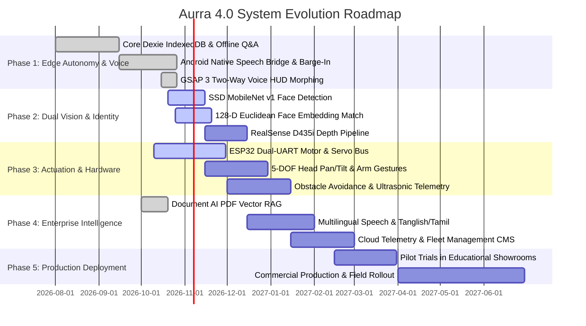

# AURRA 4.0 — Humanoid Robot & Autonomous Kiosk Roadmap
**RoboMiracle Technologies** | RS Puram, Coimbatore, Tamil Nadu, India  
*Endless Innovation — A New Era of Intelligent Beings*

---

## Executive Summary
**Aurra 4.0** is an edge-AI-integrated humanoid robotic platform and touchless autonomous kiosk developed for enterprise visitor reception, hospital patient guidance, educational campus walkthroughs, convention information delivery, and interactive public services.

This roadmap outlines the phased development, architecture milestones, AI enhancements, hardware integrations, and production deployment schedule for the Aurra ecosystem.

---

---

## Phase 1: Edge Autonomy & Voice Immersion (Current — Completed & Polished)
*Focus: 100% offline edge responsiveness, zero-latency speech arbitration, and hardware resilience.*

- [x] **Dexie.js IndexedDB Edge Storage**: Full client-side caching for Action Cards, FAQ knowledge bases, campus room directories, and robot tour profiles.
- [x] **Android Native Speech Bridge (`LauncherBridge.java`)**:
  - In-process native `android.speech.SpeechRecognizer` bypassing Android WebView Web Speech API credential restrictions.
  - Automatic error code recovery (7: `NO_MATCH`, 6: `SPEECH_TIMEOUT`, 8: `RECOGNIZER_BUSY`, 5: `CLIENT`).
  - Active cancellation before restarts to guarantee consecutive speech requests never lock.
- [x] **Deadlock-Free Speech Synthesis Mutex**:
  - Elimination of browser engine `speechSynthesis.speaking` lockups via app-governed `isWebSpeechActive` state tracking.
  - Active voice barge-in: User speech automatically cancels ongoing TTS playback without dropping the user's intent.
- [x] **Zero-Latency Instant Conversational Intents**:
  - Instant greetings (`"hello"`, `"hi"`, `"namaste"`, `"vanakkam"`, `"good morning"`, `"good afternoon"`, `"good evening"`).
  - Instant identity grounding (*"Who are you?"*, *"What is your name?"*, *"Introduce yourself"*).
  - High-priority system interruption and navigation (`"home"`, `"back"`, `"stop"`, `"features"`).
- [x] **Ground-Truth Indian Political & Administrative Persona**:
  - All 28 designated state Chief Ministers and Prime Minister Narendra Modi baked into system prompt and local knowledge base.
  - Aurra technical specifications (5 ft, 50 kg, 5-DOF, RS Puram, Coimbatore origins).
- [x] **GSAP 3 Cyber Voice HUD**:
  - Two-way seamless morphing between bottom Voice Assistant Bar capsule and the central cyber orb.
  - Multi-strand GPU-accelerated laser horizon canvas with real-time audio amplitude reaction.

---

## Phase 2: Dual Vision & Facial Identity Pipeline (In Progress)
*Focus: Touchless visitor identification, instant VIP greeting, and visual spatial awareness.*

- [x] **Client-Side Face Detection (`face-api.js`)**:
  - Lightweight SSD MobileNet v1 in-browser inference for real-time face bounding boxes.
- [x] **128-Dimensional Face Embeddings**:
  - Euclidean distance matching against registered visitor database stored in IndexedDB.
- [ ] **Dual Camera & RealSense D435i Integration**:
  - Integration with Intel RealSense D435i depth camera for millimeter-precision visitor distance measurement.
  - Autonomous wake-up: Aurra wakes from screensaver when a visitor approaches within 2.0 meters.
- [ ] **Adaptive Lighting & Night Vision Optimization**:
  - Auto-exposure and contrast compensation using the Crystal Pro 3P Lens camera.
- [ ] **VIP Visitor Auto-Greeter**:
  - Personalized voice greeting by name (e.g. *"Welcome back, Dr. Rangarajan. Opening your scheduled meeting room."*).

---

## Phase 3: Hardware Actuation & 5-DOF Spatial Navigation (Target: Q4 2026)
*Focus: Physical robotics, expressive animatronics, and autonomous mobility.*

- [x] **Hardware Dispatcher (`hardwareDispatcher.js`)**:
  - Intent matching for pan/tilt, hand waving, handshakes, hugs, and base locomotion.
- [ ] **ESP32 Microcontroller Dual-Channel Communication**:
  - High-speed UART / REST API command dispatch for servo bus control.
  - Active telemetry feedback: battery capacity percentage, motor temperature, and status pings.
- [ ] **5-DOF Physical Actuation**:
  - Head Pan (Left/Right) and Tilt (Up/Down) synchronized with face tracking.
  - Dual 2-DOF robotic arms executing 10 programmed gestures (waving, greeting, attention, pointing).
- [ ] **Mobility Base & Obstacle Avoidance**:
  - 100 mm heavy-duty caster wheel platform with differential drive.
  - Ultrasonic sensor array detecting obstacles within 50 cm and halting forward motion.

---

## Phase 4: Enterprise Intelligence & Fleet Management (Target: Q1 2027)
*Focus: Enterprise knowledge grounding, multilingual autonomy, and centralized analytics.*

- [x] **Document AI (PDF Vector Search)**:
  - On-device chunking with `pdfjs-dist` and context-grounded Q&A via Groq Cloud LLM.
- [ ] **Multilingual Speech & Regional Language Expansion**:
  - Spoken Tamil, Tanglish, Hindi, and Malayalam speech recognition and localized TTS voices.
- [ ] **Centralized Cloud Fleet Management CMS**:
  - Real-time telemetry dashboard monitoring battery levels, hardware health, and interaction counts across all deployed kiosks.
  - Remote content synchronization: Push updated action cards, announcements, and advertisements from a central web portal.
- [ ] **Live Visitor Analytics**:
  - Footfall heatmaps, average interaction durations, most asked questions, and registration metrics.

---

## Phase 5: Production Deployment & Commercial Rollout (Target: Q2 2027)
*Focus: Commercial hardening, industrial reliability testing, and institutional deployment.*

- [ ] **Showroom & Campus Pilot Testing**:
  - Deployment across educational institutions, hospital reception desks, and corporate lobbies in Coimbatore and Chennai.
- [ ] **Hardened Android Kiosk OS Image**:
  - Tamper-proof kiosk launcher mode locking physical hardware buttons and system settings.
  - Watchdog auto-restart upon any unhandled application crash.
- [ ] **CE & Safety Certification**:
  - Emergency-stop safety verification and joint pinch-point safety compliance.
- [ ] **Commercial Field Service Package**:
  - Operator training manual, on-site diagnostics mode, and modular spare-parts maintenance kit.

---

## Technical Specifications Summary

| Feature | Specification |
| :--- | :--- |
| **Physical Dimensions** | Height: 5 ft (152 cm) \| Weight: 50 kg |
| **Motion Degrees of Freedom** | 5 DOF (Head Pan/Tilt + Dual Arms + Base Wheels) |
| **On-Device Database** | Dexie.js IndexedDB v4 (Offline-First Schema) |
| **Edge Voice Recognition** | In-Process Android Native `SpeechRecognizer` + Web Speech API fallback |
| **Speech Audio Synthesis** | Android Native TTS / Web Speech API (`en-IN` Indian English voices) |
| **Cloud AI Engine** | Groq Cloud API (`qwen/qwen3.8-27b`) with Google Gemini fallback |
| **Vision Sensor** | Crystal Pro Night Vision Web Camera / Intel RealSense D435i |
| **Audio Hardware** | Fielect 8 Ohm 20W External Magnet Loudspeaker (78mm diameter) |
| **Operating System** | Android 11+ / Embedded Linux / Chromium Kiosk Shell |
| **Manufacturer** | RoboMiracle Technologies, RS Puram, Coimbatore, Tamil Nadu, India |
