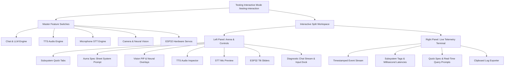
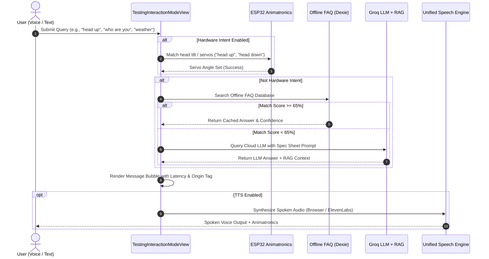

# Aurra 4.0 - Testing Interactive Mode (Feature Isolator & Diagnostic Lab)
## Comprehensive Technical Analysis & Bug Dossier

---

## 1. Executive Summary

The **Testing Interactive Mode** (`/testing-interaction`, component: [`TestingInteractionModeView.jsx`](file:///d:/RAGUNATH/aurra/aurra_v/src/pages/Interaction/TestingInteractionModeView.jsx)) is a dedicated diagnostic and isolated testing workspace built for Aurra. It was designed to allow engineers to test, calibrate, and profile individual subsystems of the humanoid robot in total isolation without interference from other autonomous background loops.

### Key Objectives of the Mode
1. **Isolated Subsystem Verification**: Test Text Chat, TTS Voice Audio, Microphone STT, Neural Face Vision, and ESP32 Animatronics independently.
2. **5-Stage Pipeline Telemetry**: Trace latency, match confidence, and origin source (Offline FAQ vs System Clock vs Groq LLM + RAG vs Fallback).
3. **Zero-Overhead Performance Telemetry**: Provide a 60 FPS telemetry loop without triggering React component re-renders.
4. **Live System Terminal**: Real-time event bus capturing timestamped logs with millisecond delta metrics.

While the core diagnostic layout and visual appearance are working smoothly, a deep architectural and code-level inspection reveals several underlying bugs, race conditions, phantom controls, and state synchronization issues.

---

## 2. Architecture & Subsystem Blueprint



---

## 3. Subsystem Breakdown & Identified Bug Catalog

### 1. ElevenLabs UI Phantom Code & Missing Controls (High Priority)
* **Location**: [`TestingInteractionModeView.jsx:39`](file:///d:/RAGUNATH/aurra/aurra_v/src/pages/Interaction/TestingInteractionModeView.jsx#L39), [`TestingInteractionModeView.jsx:136-142`](file:///d:/RAGUNATH/aurra/aurra_v/src/pages/Interaction/TestingInteractionModeView.jsx#L136-L142), [`TestingInteractionModeView.jsx:644-654`](file:///d:/RAGUNATH/aurra/aurra_v/src/pages/Interaction/TestingInteractionModeView.jsx#L644-L654), [`TestingInteractionModeView.jsx:932-965`](file:///d:/RAGUNATH/aurra/aurra_v/src/pages/Interaction/TestingInteractionModeView.jsx#L932-L965)
* **What's Happening**:
  - `elevenLabsService` and `DEFAULT_ELEVENLABS_VOICES` are imported.
  - States `elevenApiKey`, `elevenVoiceId`, `elevenCustomVoiceId`, `showApiKey`, `elevenSavedNotice` and helper `handleSaveElevenLabs` are defined.
  - **However, none of these are rendered in the JSX!**
  - In `activeTab === 'tts'`, the UI only displays a text box, a speed slider, and "Play Audio" / "Stop" buttons.
  - There is **no engine switcher** (Browser Speech vs ElevenLabs), **no API Key input**, **no Voice dropdown**, and **no custom Voice ID field**.
  - `ttsEngine` defaults to `'browser'`, leaving ElevenLabs completely inaccessible through the UI.
  - Furthermore, Browser Voices (`browserVoices`) are loaded on mount, but there is no dropdown to select Indian English voices (e.g., Neerja, Heera) in this view either.

---

### 2. Acoustic Feedback Loop: Mic Self-Interception during TTS (Critical)
* **Location**: [`TestingInteractionModeView.jsx:309-386`](file:///d:/RAGUNATH/aurra/aurra_v/src/pages/Interaction/TestingInteractionModeView.jsx#L309-L386), [`TestingInteractionModeView.jsx:543-546`](file:///d:/RAGUNATH/aurra/aurra_v/src/pages/Interaction/TestingInteractionModeView.jsx#L543-L546)
* **What's Happening**:
  - When STT (`enableStt`) is toggled ON, the microphone listens continuously (`rec.continuous = true`).
  - When the user speaks, `rec.onresult` detects the final transcript and calls `handleExecuteQuery(final.trim(), 'voice')`.
  - Step 7 of `handleExecuteQuery` automatically plays audio via `playTtsAudio(replyText)`.
  - **The microphone is NOT muted or paused while Aurra is speaking!**
  - The kiosk microphone picks up Aurra's own spoken output from the speakers, recognizes the robot's words as a new user query, and submits it back to the pipeline, causing an acoustic echo feedback loop.

---

### 3. Background Global `voiceNavigationService` Conflict (Critical)
* **Location**: [`App.jsx:109`](file:///d:/RAGUNATH/aurra/aurra_v/src/App.jsx#L109), [`voiceNavigationService.js:852`](file:///d:/RAGUNATH/aurra/aurra_v/src/services/voiceNavigationService.js#L852), [`TestingInteractionModeView.jsx:309`](file:///d:/RAGUNATH/aurra/aurra_v/src/pages/Interaction/TestingInteractionModeView.jsx#L309)
* **What's Happening**:
  - In `App.jsx`, `VoiceAssistantBar` is hidden when `currentRoute === '/testing-interaction'`.
  - However, the underlying singleton `voiceNavigationService` **is never stopped when entering this route**.
  - If the user was on the Home/Cards screen where voice navigation was active, `voiceNavigationService` continues listening in the background.
  - When the user toggles ON "Speech Input (STT)" in Testing Mode, a **second** `window.SpeechRecognition` instance is instantiated.
  - On Chromium/Android WebView, two concurrent microphone sessions either fail with `audio-capture` / `aborted` or the background service interprets test speech as a navigation command (e.g. "go home") and forcibly navigates away from Testing Mode.

---

### 4. Stale Closures in STT Handler (`handleExecuteQuery`)
* **Location**: [`TestingInteractionModeView.jsx:344-346`](file:///d:/RAGUNATH/aurra/aurra_v/src/pages/Interaction/TestingInteractionModeView.jsx#L344-L346), [`TestingInteractionModeView.jsx:386`](file:///d:/RAGUNATH/aurra/aurra_v/src/pages/Interaction/TestingInteractionModeView.jsx#L386)
* **What's Happening**:
  - The `useEffect` managing `SpeechRecognition` has a dependency array of `[enableStt, enableChat, addLog]`.
  - Inside `rec.onresult`, it calls `handleExecuteQuery(final.trim(), 'voice')`.
  - `handleExecuteQuery` is re-created on each render and references states such as `isProcessing`, `enableHardware`, `enableTts`, and `selectedLlmModel`.
  - Because `handleExecuteQuery` is not stored in a ref and not listed in the STT effect dependencies, the event listener closes over stale values from the moment `enableStt` was toggled ON.
  - If the user toggles `enableHardware` ON *after* starting STT, voice commands like "head up" will read `enableHardware === false` and fail to move the servos.

---

### 5. Camera & Vision: Mirrored Label Text & Aspect Ratio Mismatch
* **Location**: [`TestingInteractionModeView.jsx:279-288`](file:///d:/RAGUNATH/aurra/aurra_v/src/pages/Interaction/TestingInteractionModeView.jsx#L279-L288), [`TestingInteractionModeView.css:318, 328`](file:///d:/RAGUNATH/aurra/aurra_v/src/pages/Interaction/TestingInteractionModeView.css#L318)
* **What's Happening**:
  - In CSS, `.tia-video-feed` and `.tia-canvas-overlay` both have `transform: scaleX(-1)` to mirror the selfie camera.
  - In `runVisionInference`, face labels are rendered using `ctx.fillText("FACE (...)")`.
  - Because the entire canvas has `scaleX(-1)`, **the text drawn on the canvas appears completely reversed/mirrored**.
  - In addition, `.tia-video-feed` has `object-fit: cover` within a fixed 160px height viewport. When the camera feed (4:3 aspect ratio) is cropped by `object-fit: cover`, the canvas element stretches coordinates 1:1, causing bounding boxes to be visibly offset from detected faces.
  - Furthermore, clicking the **"Vision PiP"** tab (`activeTab === 'vision'`) shows the vision card, but does **not** turn on `enableVision`. The viewport displays "Camera Hardware is Stopped", confusing users who expect clicking the tab to activate the camera test.

---

### 6. ElevenLabs Telemetry Latency TDZ/Undefined Bug
* **Location**: [`TestingInteractionModeView.jsx:592-597`](file:///d:/RAGUNATH/aurra/aurra_v/src/pages/Interaction/TestingInteractionModeView.jsx#L592-L597), [`elevenLabsService.js:156-162`](file:///d:/RAGUNATH/aurra/aurra_v/src/services/elevenLabsService.js#L156-L162)
* **What's Happening**:
  ```javascript
  const res = await elevenLabsService.speak(cleanText, {
    onEnd: () => {
      setIsTtsPlaying(false);
      addLog('TTS', `[ElevenLabs] Audio playback finished (API took ${res?.latencyMs || 0}ms)`, 'timing', res?.latencyMs);
    },
  });
  ```
  - In `elevenLabsService.speak`, `callbacks.onEnd?.()` is invoked inside `audio.onended`, which fires before the outer promise resolves.
  - At the moment `onEnd` executes, `res` has not yet been assigned by the `await` statement.
  - Consequently, `res?.latencyMs` is always `undefined`, and the logged latency always reports `0ms`.

---

### 7. Missing Animatronics during ElevenLabs Voice Output
* **Location**: [`speechSynthesis.js:275-284`](file:///d:/RAGUNATH/aurra/aurra_v/src/utils/speechSynthesis.js#L275-L284), [`TestingInteractionModeView.jsx:592-608`](file:///d:/RAGUNATH/aurra/aurra_v/src/pages/Interaction/TestingInteractionModeView.jsx#L592-L608)
* **What's Happening**:
  - When speaking through Browser TTS, `speakWithVoice` calls `startSpeakingAnimatronics()` and `stopSpeakingAnimatronics()` to oscillate the head servos and trigger mouth LED gestures.
  - When `elevenLabsService.speak` is used, neither the service nor `TestingInteractionModeView.jsx` calls `startSpeakingAnimatronics()`.
  - As a result, the robot remains completely rigid and frozen while ElevenLabs audio plays.

---

### 8. LLM Model Discrepancy & Incompatibility with Admin Dashboard
* **Location**: [`TestingInteractionModeView.jsx:821-825`](file:///d:/RAGUNATH/aurra/aurra_v/src/pages/Interaction/TestingInteractionModeView.jsx#L821-L825), [`AdminDashboard.jsx:2272-2276`](file:///d:/RAGUNATH/aurra/aurra_v/src/pages/Admin/AdminDashboard.jsx#L2272-L2276), [`llmService.js:102-104`](file:///d:/RAGUNATH/aurra/aurra_v/src/services/llmService.js#L102-L104)
* **What's Happening**:
  - In `AdminDashboard.jsx`, the models available are:
    1. `llama-3.3-70b-versatile`
    2. `grok-beta`
    3. `llama-3.1-8b-instant`
    4. `mixtral-8x7b-32768`
  - In `TestingInteractionModeView.jsx`, the dropdown options are:
    1. `qwen/qwen3.8-27b`
    2. `openai/gpt-oss-20b`
    3. `openai/gpt-oss-120b`
    4. `allam-2-7b`
  - In `llmService.js`, `llama-3.3-70b` is automatically overwritten with `qwen/qwen3.8-27b` on load.
  - If a user configures a model in Admin Dashboard, it does not appear in the Testing Mode dropdown, and selecting a model in Testing Mode saves a model key not recognized by the Admin Dashboard selector.

---

### 9. Log Terminal Flooding & Component Re-Renders from 6s Hardware Polling
* **Location**: [`TestingInteractionModeView.jsx:389-408`](file:///d:/RAGUNATH/aurra/aurra_v/src/pages/Interaction/TestingInteractionModeView.jsx#L389-L408)
* **What's Happening**:
  - When `enableHardware` is active, `setInterval(checkHardwareStatus, 6000)` polls the ESP32.
  - When testing in a development environment or when the robot's ESP32 is powered off, every 6 seconds `addLog` appends an OFFLINE entry to `logs`.
  - Appending to `logs` triggers a full component re-render every 6 seconds, which causes scrolling jumps in the chat area and floods the diagnostic terminal with repetitive warning lines.

---

### 10. Single-Turn Only (No Multi-Turn Conversation Memory)
* **Location**: [`TestingInteractionModeView.jsx:490`](file:///d:/RAGUNATH/aurra/aurra_v/src/pages/Interaction/TestingInteractionModeView.jsx#L490)
* **What's Happening**:
  - `llmService.generateResponse(query, [])` is always called with an empty history array `[]`.
  - As a result, follow-up queries like "Who is the CEO?" followed by "What is his contact number?" fail because context is completely discarded on every turn.

---

### 11. Blocking `alert()` & Unhandled Rejection in Clipboard Copy
* **Location**: [`TestingInteractionModeView.jsx:1218-1220`](file:///d:/RAGUNATH/aurra/aurra_v/src/pages/Interaction/TestingInteractionModeView.jsx#L1218-L1220)
* **What's Happening**:
  - The "Copy" button uses `navigator.clipboard.writeText(txt); alert('Logs copied to clipboard!');`.
  - On HTTP origins or non-focused WebViews, `writeText` rejects with a permission error (unhandled rejection).
  - The modal `alert()` pauses JavaScript execution, freezes the 60 FPS animation loop, and creates a disruptive popup on kiosk touchscreens.

---

## 4. Pipeline Execution & Decision Matrix



---

## 5. Summary Table of Identified Bugs

| ID | Issue Description | Severity | Impacted Subsystem |
|---|---|---|---|
| **BUG-01** | Missing ElevenLabs controls, voice picker, and API key input in UI | High | Audio TTS / ElevenLabs |
| **BUG-02** | Acoustic echo feedback loop (STT continuously listens while TTS speaks) | Critical | Voice STT & Audio TTS |
| **BUG-03** | Global `voiceNavigationService` not paused/cleaned up upon entering testing mode | Critical | App Routing & Voice Nav |
| **BUG-04** | Stale closures in STT `onresult` handler causing ignored hardware/prompt changes | High | Speech Recognition & Pipeline |
| **BUG-05** | Mirrored text on canvas overlay & aspect-ratio bounding box misalignment | Medium | Camera & Neural Vision |
| **BUG-06** | Vision tab does not activate camera if master switch is off | Medium | UI / Camera Lifecycle |
| **BUG-07** | ElevenLabs `latencyMs` evaluates to `0ms` (Temporal Dead Zone / Async timing) | Low | Diagnostic Telemetry |
| **BUG-08** | Robot animatronics / mouth gestures do not animate during ElevenLabs speech | High | Robot Physical Animatronics |
| **BUG-09** | LLM model list mismatch between Admin Dashboard and Testing Mode | Medium | Cloud LLM Configuration |
| **BUG-10** | Hardware polling every 6s floods terminal logs and triggers re-renders | Medium | Performance / Telemetry |
| **BUG-11** | Zero multi-turn conversation memory passed to LLM (`[]` empty array) | Medium | Conversational Testing |
| **BUG-12** | Synchronous `alert()` and unhandled clipboard promise rejection | Low | Kiosk UX / Crash Prevention |

---

## 6. Resolved in Branch `oct-6`

### Fix 1: Eliminating Double Speech Input & Duplicate Pipeline Responses
1. **Synchronous Execution Lock**: Added `isProcessingRef.current = true;` synchronously at the entry of `handleExecuteQuery`, rejecting any overlapping or duplicate invocations immediately.
2. **Utterance Debounce & De-duplication**: Discarded identical speech utterances detected within 2.5 seconds or any new speech chunks within 1.2 seconds.
3. **Anti-Echo Audio Shield**: Integrated `isSpeakingRef.current = true;` during speech synthesis with a 600ms acoustic grace period, ensuring Aurra never listens to or transcribes her own voice output.
4. **Isolated Speech Session**: Automatically paused background `voiceNavigationService` on mount to prevent concurrent dual `SpeechRecognition` conflicts.

### Fix 2: Autonomous Face Greeting with Configurable Buffer Cooldown
1. **Descriptor Embedding Extraction**: Switched `detectFacesInVideo` options to `{ withDescriptors: true }` so 128-float facial embeddings are computed on every inference pass.
2. **Enrolled VIP Biometric Matching**: Loaded registered users from `offlineFaceService.getUsers()` and computed Euclidean distance matching (`< 0.55`) against detected face descriptors.
3. **Greeting Cooldown Buffer**: Added a buffer cooldown system (configurable via dropdown: 15s, 30s, 45s default, 60s, 90s). The robot welcomes a visitor once upon arrival and suppresses repetitive greetings.
4. **Departure Detection**: When no face is in view for 15 seconds, greeting buffers automatically reset so the next visitor arrival is promptly welcomed.
5. **Non-Mirrored Text Overlay**: Removed `scaleX(-1)` from `.tia-canvas-overlay` and mapped canvas coordinates `canvas.width - (box.x + box.width)` to keep cyber reticles aligned while ensuring all text badges (`VIP: NAME`, `GUEST`) are rendered in crisp, un-mirrored orientation.
6. **Unified Greeting Output**: Greeted visitors trigger chat stream entries with the `FACE RECOGNITION GREETING` tag, optional spoken voice welcoming, and head tilt animatronics.
